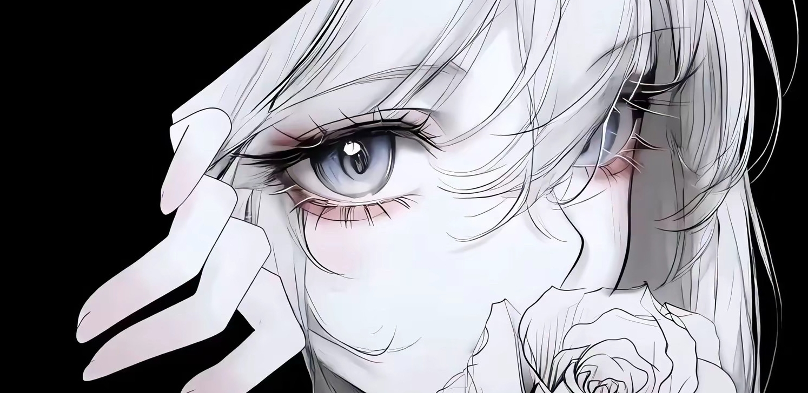

## Introduction
> 来自南京邮电大学，现读大二.
>From Robocon Initial Team.

## Video

## Tech

[github-sub-title:img]: https://readme-typing-svg.herokuapp.com?font=Segoe+Script&center=true&lines=cha815.

## Connect Me
> QQ:3110627283@qq.com
